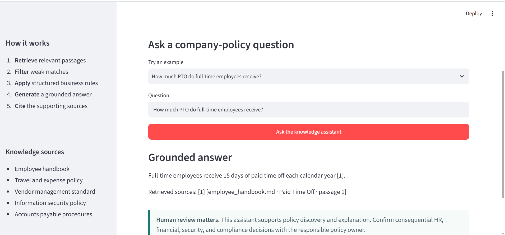

## Application preview



# Company Knowledge RAG Assistant

A local, citation-grounded AI assistant for searching company policies and procedures.

The project combines semantic retrieval, a local Qwen language model, relevance-based refusal, and deterministic business rules. It demonstrates how a company can make internal knowledge easier to use without treating an LLM as the source of truth.

## Demonstrated architecture

```text
Company documents
        ↓
Citation-ready passages
        ↓
Local Ollama embeddings
        ↓
Semantic retrieval
        ↓
Relevance threshold
        ↓
Structured rules or local Qwen
        ↓
Grounded answer with citations
```

## Features

- Local document ingestion for Markdown, text, and PDFs
- Semantic embeddings using Ollama and `nomic-embed-text`
- Lightweight NumPy vector index
- Filename, section, page, and passage metadata
- Local Qwen answers constrained to retrieved evidence
- Refusal when available documents do not support an answer
- Deterministic invoice-approval rules for numerical reliability
- Streamlit web interface
- Twenty-question retrieval evaluation set
- Automated retrieval and business-rule tests

## Fictional demonstration data

The included documents cover employee policies, travel and expenses, vendor controls, information security, and accounts payable. All company names, policies, amounts, and scenarios are fictional.

## Requirements

- Python 3.11 or newer
- Ollama
- `nomic-embed-text`
- `qwen3:4b-instruct-2507-q4_K_M`

## Windows setup

```powershell
py -m venv .venv
.\.venv\Scripts\Activate.ps1
python -m pip install --upgrade pip
pip install -r requirements.txt
```

Install the local Ollama models:

```powershell
& "$env:LOCALAPPDATA\Programs\Ollama\ollama.exe" pull nomic-embed-text
& "$env:LOCALAPPDATA\Programs\Ollama\ollama.exe" pull qwen3:4b-instruct-2507-q4_K_M
```

Build the local vector index:

```powershell
python -m src.ingest
```

## Run the web application

```powershell
streamlit run app.py
```

Then open `http://localhost:8501`.

## Command-line examples

```powershell
python -m src.retrieve "What is the company's PTO policy?"
python -m src.assistant "When must employees submit expense reports?"
python -m src.assistant 'Who must approve a $12,000 invoice?'
```

Use single quotes around PowerShell questions containing a dollar sign.

## Evaluation

```powershell
python -m src.evaluate
python -m unittest discover -s tests -v
```

Current verified results:

```text
Retrieval Recall@5: 20/20 = 100%
Automated tests: 5 passed
```

## Why deterministic rules matter

During development, retrieval correctly found the invoice-approval policy, but the small language model misclassified a `$12,000` invoice.

The project therefore routes numerical invoice-approval questions through structured JSON rules and validated Python logic. The LLM remains useful for policy discovery and explanation, while deterministic code handles decisions that require exact threshold comparisons.

> Retrieval can be correct while generation is wrong.

Reliable business AI requires retrieval evaluation, answer testing, structured business context, safety controls, and human review—not simply a chatbot connected to documents.

## Privacy and safety

The assistant runs locally through Ollama. For real company deployments, define document permissions, data retention, access logging, approved model usage, evaluation standards, and policy-owner review before ingesting confidential information.

The application supports knowledge discovery. It does not replace responsible HR, financial, security, legal, or compliance review.
